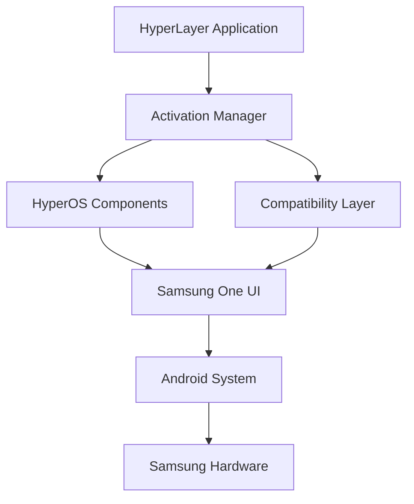

# HyperLayer

&#x20; \<strong>A HyperOS interface layer for Samsung One UI.\</strong>
&#x20; \ 
&#x20; Integrating Xiaomi's software experience while preserving the Samsung system.

&#x20; )
&#x20; )
&#x20; )
&#x20; )
&#x20; )

---

## Overview

HyperLayer is an Android customization project focused on bringing the HyperOS interface and selected system features to Samsung devices running One UI.

Rather than replacing the existing operating system with a custom ROM, HyperLayer introduces a software layer that adapts Xiaomi components and integrates them with Samsung's Android environment.

The project aims to preserve the original firmware, hardware support and Samsung services while providing an alternative user interface.

## How it works

HyperLayer is designed around a centralized application that manages the activation and deactivation process.

1. **Device detection** — Identify the device model, Android version and supported features.
2. **Compatibility check** — Verify the availability of required components and permissions.
3. **Activation** — Apply the selected HyperOS components and interface modifications.
4. **Integration** — Configure the components to work with the existing One UI environment.
5. **Restoration** — Revert HyperLayer-managed modifications and return to the original configuration.

The main interface will provide a single **Switch** control to manage this process.

Advanced integrations may require additional permissions, root access or a system restart, depending on the component and device configuration.

## Features

The project aims to integrate the following components:

| Component      | Description                                                    |
| -------------- | -------------------------------------------------------------- |
| Launcher       | HyperOS home screen, application drawer and desktop management |
| Control Center | HyperOS-style quick settings interface                         |
| Notifications  | Adapted notification interface and interactions                |
| Status Bar     | Visual customization and system integration                    |
| Lock Screen    | HyperOS-inspired lock screen components                        |
| Animations     | Interface transitions and window animations                    |
| Widgets        | Xiaomi widget integration and compatibility                    |
| Visual Effects | Blur, transparency and interface styling                       |

Feature availability will depend on the capabilities and limitations of the underlying Samsung system.

## System Architecture

HyperLayer operates as an additional software layer rather than a replacement operating system.

The original One UI environment remains responsible for hardware support, drivers, security and core Android services.

HyperLayer manages the adapted interface components and provides the compatibility mechanisms required for their integration.

## Target Platform

Initial development and testing are focused on the following configuration:

| Specification    | Target                                 |
| ---------------- | -------------------------------------- |
| Device           | Samsung Galaxy S23                     |
| Model            | SM-S911B                               |
| Processor        | Qualcomm Snapdragon 8 Gen 2 for Galaxy |
| Architecture     | ARM64                                  |
| Operating System | One UI 9                               |
| Android Version  | Android 17                             |

Additional Samsung devices may be supported in future development stages.

## Development Roadmap

- [ ] Initial application interface.
- [ ] Device detection and compatibility validation.
- [ ] Activation and restoration system.
- [ ] MiuiHome integration.
- [ ] Xiaomi framework compatibility.
- [ ] Control Center integration.
- [ ] Notification interface.
- [ ] Status Bar integration.
- [ ] Lock Screen integration.
- [ ] Animation and transition adaptation.
- [ ] Component integration and consistency.
- [ ] Stability and performance testing.

## Project Status

HyperLayer is currently in the research and early development stage.

The initial development focus is adapting MiuiHome, resolving its HyperOS dependencies and establishing the compatibility layer required for standalone operation.

The features described in this document represent development objectives and are not necessarily implemented.

## Design Principles

- **Preserve the original system:** Avoid replacing Samsung firmware or essential system components.
- **Modular architecture:** Keep interface components independent and manageable.
- **Reversible changes:** Provide a restoration mechanism for modifications managed by HyperLayer.
- **Compatibility:** Adapt Xiaomi components to the existing Android environment.
- **Stability:** Prioritize reliable operation and minimize unnecessary system modifications.

## Screenshots

Interface previews and development screenshots will be added as components become functional.

## License

HyperLayer is distributed under the Apache License 2.0.

See [LICENSE](LICENSE) for the complete license terms.

## Disclaimer

HyperLayer is an independent project and is not affiliated with, endorsed by or supported by Samsung or Xiaomi.

All trademarks, software components and proprietary resources remain the property of their respective owners.
